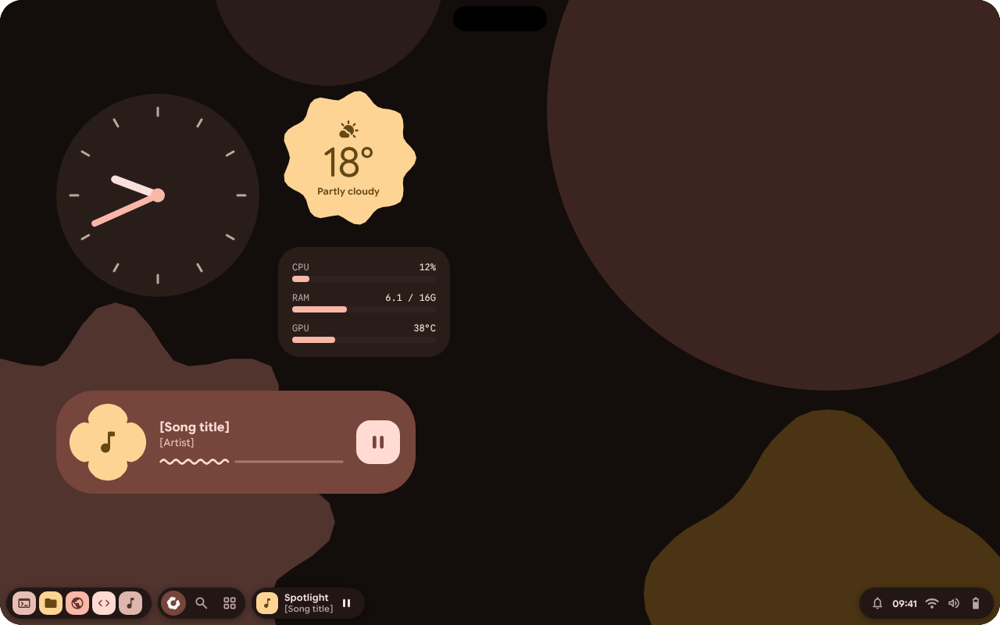

# Reef

**A desktop that moves like it's alive and looks like it was made with care.**

Reef is a full desktop environment built with **Quickshell** on **Hyprland**. It takes its motion and shapes from **Material 3 Expressive** and its restraint from **Apple**: the playfulness goes into how things move and what shape they take, while color and density stay calm. Colors come from the wallpaper (like Caelestia), but Reef has its own identity.



## The pieces

| Name | What it is |
| --- | --- |
| **Reef** | The desktop environment |
| **The Island** | A black pill at the top center for live activities (media, timers, recordings, notifications) with tabs: Now, Shelf, Clipboard, Tools, Coral |
| **The Pearl** | The round form the Island morphs into: the lock screen centerpiece and Coral's voice mode |
| **Coral** | The built-in AI assistant, working with any OpenAI-compatible endpoint, including local models |
| **Cays** | The four separate pills that make up the bar: Dock, Navigator, Spotlight, Status |
| **Tide panels** | Full-height panels attached to a screen edge: the control/notification center and edit mode |
| **The Shelf** | A temporary holding area for files and text, inside the Island |

## Repository map

```
README.md            ← you are here
CLAUDE.md            ← working agreement for Claude Code
docs/
  DESIGN.md          ← brand book: principles, color, shape, type, icons, logo, sound, voice
  MOTION.md          ← M3 Expressive springs, choreography, signature moments, reduce motion
  SURFACES.md        ← every surface's behavior + global rules (rounded screen, Tide panels, …)
  ARCHITECTURE.md    ← proposed Quickshell/Hyprland implementation, services, config
  ROADMAP.md         ← milestones M0–M9
design/
  tokens.json        ← color roles (4 themes), type, spacing, radius, size, shadow
  logo/              ← Reef mark (atoll ring) – color, on-dark, mono SVGs
  fonts/             ← Google Sans Flex, Google Sans Code, Material Symbols Rounded (web, for mockups) + licenses
  mockups/           ← refined mockups: screens/ and parts/ (PNG), html/ (static HTML), README index
mockup/              ← original hand-drawn Excalidraw flow + images
reef/                ← the Quickshell config (run: qs -p ./reef, or symlink to ~/.config/quickshell/reef)
hypr/                ← Hyprland snippet (reef.lua) + generated tokens.lua
```

## Status

**M0–M3 are done**: tokens, live colors, motion, type, icons, shapes, config, a dev window (`qs -p ./reef ipc call reef dev`), the rounded screen, the four-cay bar, the Island (live activities, peek, Now tab, notifications), the floating OSD, toasts, the control center and quick menus. M4 has started: search (tap Super) is in; the workspace overview and window switcher are next in [docs/ROADMAP.md](docs/ROADMAP.md).

## Design at a glance

- **Color:** M3 roles generated from the wallpaper. A **Colorfulness** setting offers Neutral, Tinted (the default) or Vivid. Light, Dark or Auto. The Island is always pure black.
- **Shape:** the screen corners are rounded. Corners follow the M3 scale and nest concentrically. M3E shapes appear across the UI: password dots, toggles, widgets, the Pearl.
- **Type:** Google Sans Flex, with variable axes for motion. Google Sans Code for mono text. Material Symbols Rounded for icons.
- **Motion:** M3 Expressive springs, interruptible, with Reduce motion and an animation speed setting.
- **Everything is a setting**, including per monitor.
